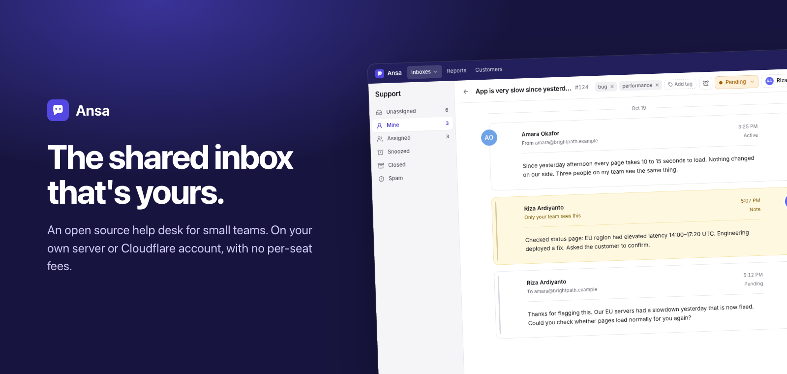
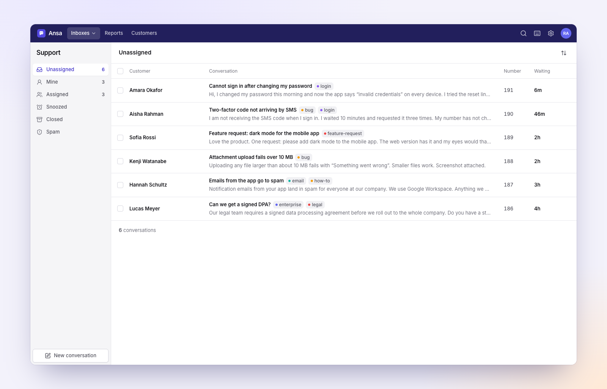
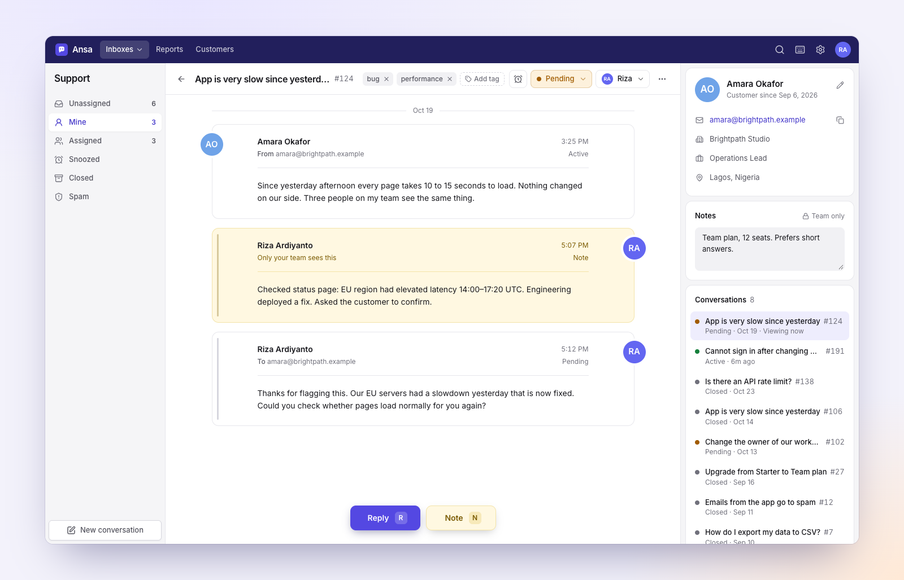
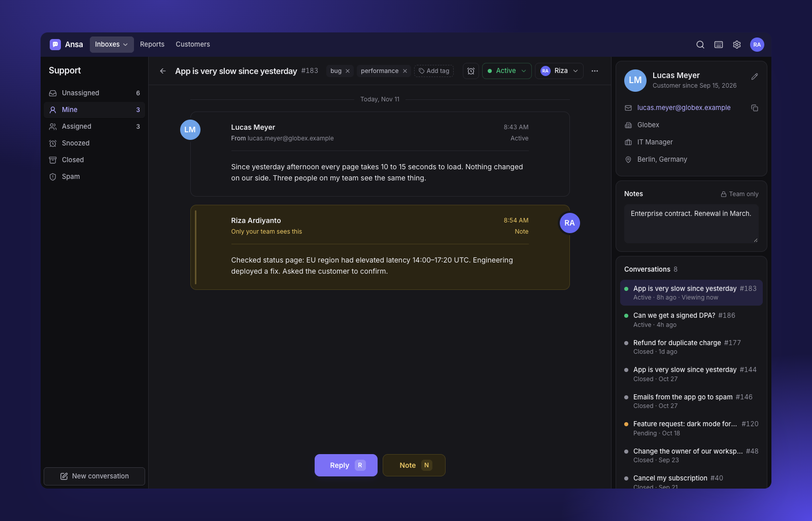
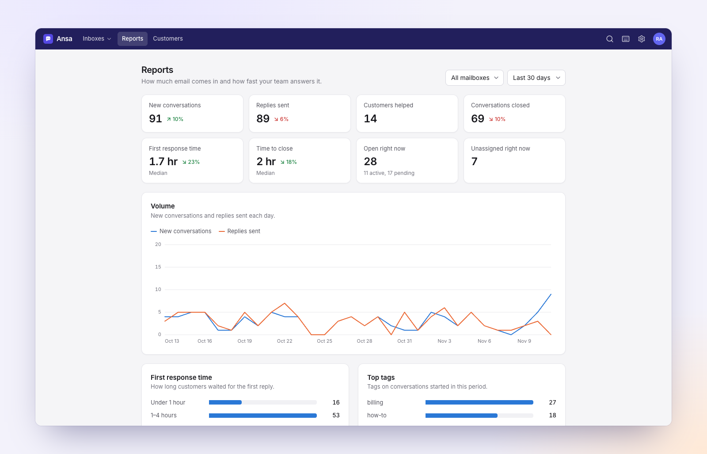
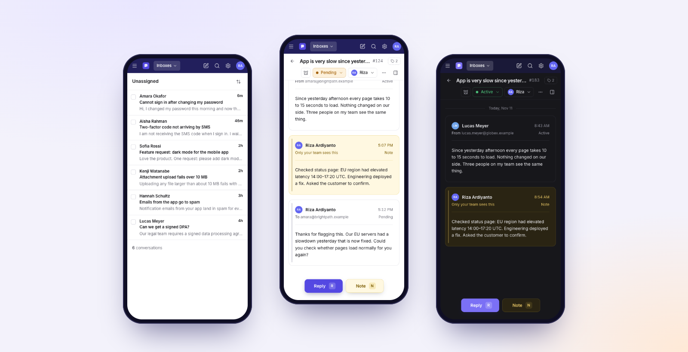
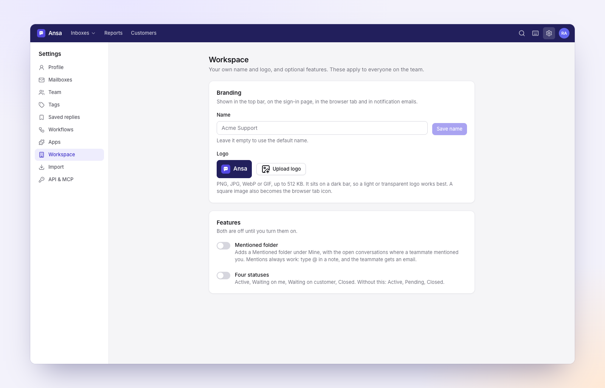

<p align="center">
  
</p>

<p align="center">
  A shared inbox and help desk that you host yourself.<br>
  Mailboxes, notes, assignments, workflows, reports and an MCP server, on a VPS or on Cloudflare.
</p>

<p align="center">
  <a href="https://deploy.workers.cloudflare.com/?url=https://github.com/rizaardiyanto1412/ansa"></a>
</p>

<p align="center">
  <a href="#everything-a-support-team-needs">Features</a> ·
  <a href="#ansa-and-help-scout-side-by-side">Ansa vs Help Scout</a> ·
  <a href="#what-it-costs">What it costs</a> ·
  <a href="#get-started">Get started</a> ·
  <a href="docs/self-hosting.md">Self-hosting guide</a>
</p>

## Why Ansa

**Pay for the help desk, not for every person in it.** Ansa is free and open source. You pay only for
where it runs: a small VPS, or your Cloudflare account. Add the whole team and the price stays the
same.

**Own your customer email.** Every conversation, note and attachment lives in one SQLite database on
your server or in your Cloudflare account. Nobody else hosts your support inbox, and the code is yours
to read, change and run.

**Keep your email address.** Ansa sends through your own SMTP server and reads your inbox over IMAP.
It works with Google Workspace, Microsoft 365, Fastmail and any standard provider, and replies thread
correctly in the customer's mail client.

**Little to look after.** One container with one database file, or one Cloudflare Worker. No external
services, queues or caches.

## Everything a support team needs

### One inbox for the whole team

Each mailbox is an email address your team answers together. Conversations sort into Unassigned,
Mine, Assigned, Snoozed, Closed and Spam. Assign a conversation, tag it, snooze it until later, merge
two into one, or move it to another mailbox. Select several to change them at once.



<p align="center">
  <sub>The people and conversations in these screenshots are made up: they're the demo data that <code>npm run seed</code> creates.</sub>
</p>

### Conversations that read like a conversation

Reply in rich text with attachments, Cc and Bcc. Drafts save as you type. Add a note that only your
team sees, and type `@` to mention a teammate. Each message shows the status it was sent with, and a
warning appears when a teammate views or answers the same conversation.

The customer's profile sits beside the thread, with your team's notes and every conversation that
person had with you. One customer can have several email addresses.



### Light and dark

Light, dark, or whatever your system says.



### Answer faster

- **Saved replies** with placeholders such as `{{customer.firstName}}`.
- **Workflows.** Rules that tag, assign, close or annotate incoming email.
- **Auto reply** for new conversations.
- **Reply by email.** Teammates get a notification email for new assignments, customer replies and
  mentions. Reply to it from your mail client, and Ansa sends your answer to the customer.
- **Search** across subjects, messages, notes and customers. Press `⌘K`.
- **Keyboard shortcuts** for everything you do often. Press `?` to see them.

### Reports

Volume, first response time, time to close, busiest hours, top tags and team activity, for one mailbox
or all of them.



### On your phone

Add Ansa to your home screen on an iPhone or Android phone. It opens full screen, like an app, with a
layout made for small screens.



### AI assistants, apps and an API

- **MCP server.** Assistants such as Claude can read conversations, add notes, tag, and reply. They
  act as the teammate who created the token. See [MCP server and REST API](docs/api.md).
- **Apps.** Show data from your own tools beside a conversation, with no code or with live HTML from
  your endpoint. Get signed webhooks when things happen. See [Build an app](docs/apps.md).
- **REST API.** Everything the web app does, with the same token.

### Make it yours

Put your own name and logo in the app, on the sign-in page and in notification emails. Turn on four
statuses (Active, Waiting on me, Waiting on customer, Closed) or a Mentioned folder if your team works
that way.



### Move from Help Scout

Import conversations, notes, customers, tags and attachments through Help Scout's API. The import
runs in the background, can be stopped and resumed, and changes nothing in Help Scout. See
[Import from Help Scout](docs/self-hosting.md#import-from-help-scout).

## Ansa and Help Scout, side by side

Help Scout does more, and charges for it per person. Ansa does the everyday core of a shared inbox,
and it's yours. Help Scout's plans are as [helpscout.com/pricing](https://www.helpscout.com/pricing/)
listed them in November 2026.

### Price and ownership

| | Ansa | Help Scout |
|---|---|---|
| **Price** | Free and open source. You pay for a VPS, or for Cloudflare | Free plan, or $25 (Standard), $45 (Plus) or $75 (Pro) per user a month |
| **Team size** | No limit | Free: up to 5 users. Standard: up to 25. Plus: up to 50 |
| **Mailboxes** | No limit | Free: 1. More on paid plans, and extra inboxes cost more |
| **Where it runs** | Your server or your Cloudflare account | Help Scout's cloud |
| **Source code** | MIT license, on GitHub | Closed |
| **Branding** | Your name and logo | Help Scout's |

### The shared inbox

| | Ansa | Help Scout |
|---|---|---|
| **Shared mailboxes, assignment, tags, snooze, merge** | ✅ | ✅ |
| **Internal notes and mentions** | ✅ | ✅ |
| **Collision detection** | ✅ | ✅ |
| **Saved replies and workflows** | ✅ | ✅ (Free: 10 saved replies) |
| **Customer profiles with several email addresses** | ✅ | ✅ |
| **Reports** | ✅ | ✅ (Free: 30 days of history) |
| **Search** | ✅ | ✅ |
| **Light and dark** | ✅ | ✅ |
| **Phones** | ✅ home screen web app | ✅ native iPhone and Android apps |
| **API and webhooks** | ✅ | ✅ |
| **MCP server for AI assistants** | ✅ built in | — |

### Where Help Scout does more

| | Ansa | Help Scout |
|---|---|---|
| **Knowledge base** | — | ✅ Docs |
| **Live chat and a help widget** | — | ✅ Beacon |
| **Built-in AI** | — bring your own assistant through MCP | ✅ AI answers, drafts and summaries |
| **Satisfaction ratings** | — | ✅ |
| **Custom fields** | — | ✅ |
| **Ready-made integrations** | — build your own with Apps | ✅ a directory of integrations |
| **Push notifications** | — email notifications only | ✅ |
| **Single sign-on** | — | ✅ on higher plans |
| **Support** | GitHub issues | ✅ a support team |

If your team needs a knowledge base, live chat and ready-made integrations, Help Scout earns its
price. If you want a fast, calm shared inbox that you own outright, Ansa is built for you.

## What it costs

Ansa is free. You pay for where it runs:

| | What you pay |
|---|---|
| **On a VPS** | Whatever your server costs. Ansa is one container with one SQLite file, so a small server is enough. |
| **On Cloudflare, to try it** | $0 on the [Workers Free](https://developers.cloudflare.com/workers/platform/pricing/) plan. |
| **On Cloudflare, for a team** | $5 a month on Workers Paid, for the whole account. A team that keeps Ansa open all day needs it, and so does a large import. |
| **Email** | Nothing extra. Ansa uses the mailbox you already have. |

## Get started

### Deploy to Cloudflare

1. Click **Deploy to Cloudflare** above. Cloudflare copies Ansa to your GitHub account, builds it and
   deploys it. Accept the suggested build and deploy commands.
2. Open your Worker's `workers.dev` address and create the admin account. Do this right away: until
   an admin exists, anyone who finds the address can create it.
3. Connect your mailbox in **Settings → Mailboxes**.

From then on, every push to your copy deploys again. You don't create a database, a bucket or a
secret: one Durable Object holds everything.

### Install on a VPS

You need a server with Docker, and a domain name that points to it.

```bash
git clone https://github.com/rizaardiyanto1412/ansa.git ansa && cd ansa
cp .env.example .env
nano .env                      # set DOMAIN and APP_URL
docker compose --profile https up -d --build
```

Open `https://your-domain`, create the admin account, and connect your mailbox. Caddy gets and renews
the HTTPS certificate for you.

### Try it on your computer

With Node.js 22.13 or newer:

```bash
npm install
npm run seed     # demo data: sign in with demo@ansa.local / demo1234
npm run dev      # web app at http://localhost:5173
```

The [self-hosting guide](docs/self-hosting.md) covers updates, backups, Google Workspace, your own
domain, the Help Scout import and every setting.

## How it's built

- **One codebase, two homes.** The same TypeScript server ([Hono](https://hono.dev) and SQLite) runs
  on Node.js with a database file, and on Cloudflare Workers inside one
  [Durable Object](https://developers.cloudflare.com/durable-objects/).
- **Standard email.** SMTP to send and IMAP to read, with your provider's own servers. On a VPS new
  mail arrives at once; on Cloudflare Ansa checks every 60 seconds.
- **Secure by default.** A strict Content Security Policy, hashed passwords, and saved mail passwords
  encrypted with a key that never leaves your server.
- **A plain web app.** React, Vite and Tailwind.

## Learn more

- [Self-hosting guide](docs/self-hosting.md): VPS and Cloudflare installs, updates, backups, Google
  Workspace, the Help Scout import and settings.
- [MCP server and REST API](docs/api.md): connect an AI assistant, or script Ansa yourself.
- [Build an app](docs/apps.md): sidebar panels and webhooks, with two working examples.
- [Development](docs/development.md): the code's layout, running Ansa locally and tests.

## Credits

Ansa is [MIT licensed](LICENSE). Its icons are [Lucide](https://lucide.dev)'s.

Help Scout is a trademark of its owner. Ansa is not created by, affiliated with, or supported by Help
Scout. The same is true of FreeScout, Google, Microsoft, Fastmail and Cloudflare, whose names appear
here only to say what Ansa works with.
