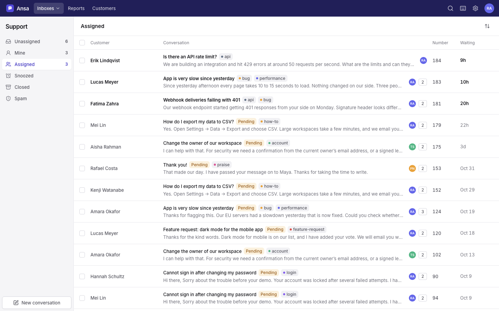
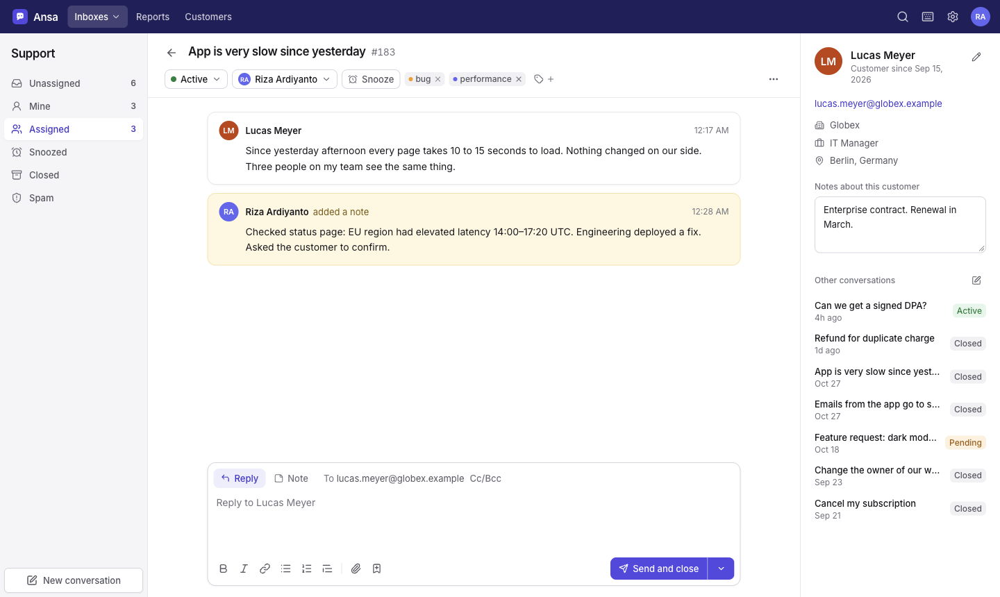

# Ansa

A self-hosted shared inbox and help desk for small teams. Connect a support address, answer customers together, and let AI assistants help through the built-in MCP server.

Run it on a VPS as one container with one SQLite file, or on Cloudflare Workers with one click. No external services.





## What you get

- **Shared mailboxes.** Each mailbox is an email address your team answers together. Folders: Unassigned, Mine, Assigned, Snoozed, Closed, Spam.
- **Your own email.** Ansa sends through your SMTP server and reads your inbox over IMAP. Works with Google Workspace, Microsoft 365, Fastmail and any standard provider. Replies thread correctly in the customer's mail client.
- **Conversations.** Rich-text replies, internal notes, attachments, Cc/Bcc, drafts that save as you type, status, assignee, tags, snooze, merge, and move between mailboxes.
- **Collision detection.** See when a teammate views or answers the same conversation.
- **Customers.** A profile for each person, with every conversation they had with you.
- **Saved replies** with placeholders such as `{{customer.firstName}}`.
- **Workflows.** Rules that tag, assign, close or annotate incoming email.
- **Auto reply** for new conversations, and email notifications for teammates. Reply to a notification from your mail client, and Ansa sends your answer to the customer.
- **Reports.** Volume, response time, resolution time, busiest hours, tags and team activity.
- **Search** across subjects, messages, notes and customers. Press `⌘K`.
- **MCP server and REST API.** Assistants such as Claude can read, tag, note and reply.
- **Apps.** Show data from your own tools beside a conversation, and get webhooks when things happen. See [Build an app](docs/apps.md).
- **Keyboard shortcuts, dark mode, mobile layout.**

## Install on a VPS

You need a server with Docker, and a domain name that points to it.

```bash
git clone <this repository> ansa && cd ansa
cp .env.example .env
nano .env                      # set DOMAIN and APP_URL
docker compose --profile https up -d --build
```

Open `https://your-domain`. The first visit asks you to create the admin account, then to connect your mailbox. Do this right after the first start: until an admin exists, anyone who finds the address can create it.

Caddy gets and renews the HTTPS certificate for you. Ports 80 and 443 must be open.

**Already have a reverse proxy** (nginx, Traefik, Cloudflare Tunnel)? Skip the profile and point your proxy at port 3000:

```bash
docker compose up -d --build   # serves http://127.0.0.1:3000
```

**Want to look around first?** Load demo data into an empty install, then sign in with `demo@ansa.local` / `demo1234`:

```bash
docker compose exec ansa node dist/seed.js
```

### Update

```bash
git pull && docker compose --profile https up -d --build
```

Database changes apply by themselves on start.

### Back up

Everything lives in the `ansa-data` volume: `ansa.db` (all data), `attachments/` and `secret.key`.

```bash
docker run --rm -v ansa_ansa-data:/data -v "$PWD":/backup alpine \
  tar czf /backup/ansa-backup-$(date +%F).tar.gz -C /data .
```

Keep `secret.key` with the database. It encrypts the saved mail passwords, and they cannot be read without it.

## Deploy to Cloudflare

[](https://deploy.workers.cloudflare.com/?url=https://github.com/rizaardiyanto1412/ansa)

The button copies this repository to your GitHub account, builds it, and deploys it to your Cloudflare account. Accept the suggested build and deploy commands. When it finishes, open the `workers.dev` address, create the admin account, and connect your mailbox.

The button only works while this repository is public. For a private repository, deploy from your machine:

```bash
npm ci
npx wrangler login
npm run deploy
```

How it runs on Cloudflare:

- **One Worker and one Durable Object.** The Durable Object's built-in SQLite database holds all data, attachments included. You do not create a database, a bucket or a secret.
- **Email works the same way.** Ansa sends over SMTP and reads over IMAP with the settings from **Settings → Mailboxes**. It checks for new mail every 60 seconds (`IMAP_POLL_SECONDS` in `wrangler.jsonc`), because a Worker cannot hold a connection open.
- **Use port 587 or 465 for SMTP.** Cloudflare blocks port 25.
- **Your domain.** Add a custom domain to the Worker in the Cloudflare dashboard. Links in notification emails use the address you sign in on. To pin it, set `APP_URL` under `vars` in `wrangler.jsonc`.
- **Plan.** The free plan is enough to try Ansa. For a team that keeps it open all day, use Workers Paid: an open browser tab keeps the Durable Object awake, and the free plan's daily allowance covers about one tab.
- **Backups.** Cloudflare keeps 30 days of point-in-time recovery for the Durable Object. There is no file to download.
- **Updates.** Push to the repository that the button created. Cloudflare rebuilds and deploys it.

Try it locally with `npm run dev:cf` (http://localhost:8787).

## Connect Google Workspace or Gmail

Google does not accept your normal password for SMTP and IMAP. Use an app password.

1. Turn on **2-Step Verification** for the Google account that owns the support address.
2. Create an app password at <https://myaccount.google.com/apppasswords>.
3. In Ansa, open **Settings → Mailboxes → Add mailbox** and choose **Google Workspace or Gmail**. This fills in the servers:

   | | Host | Port | Security |
   |---|---|---|---|
   | SMTP | `smtp.gmail.com` | 587 | STARTTLS |
   | IMAP | `imap.gmail.com` | 993 | SSL/TLS |

4. Username: the full email address. Password: the 16-character app password.
5. Press **Test connection** in both sections, then save.

If your Workspace admin disabled app passwords, ask them to allow them for this account. If the address is an alias or a group, sign in as the real mailbox that receives its mail, and add the alias under Gmail's **Send mail as** setting so Google lets you send from it.

Ansa only reads mail. It does not delete or move anything in your Google inbox. By default it imports mail that arrives after you connect; tick **Import the last 30 days** to bring in recent history.

## Connect an AI assistant (MCP)

Ansa serves the Model Context Protocol at `https://your-domain/mcp` (Streamable HTTP).

1. Open **Settings → API & MCP** and create a token. The page shows ready-to-paste setup for Claude Code, Claude Desktop and Cursor.
2. For Claude Code:

   ```bash
   claude mcp add --transport http ansa https://your-domain/mcp \
     --header "Authorization: Bearer ansa_your_token"
   ```

The assistant acts as the teammate who created the token. Revoke the token to cut it off.

| Tool | What it does |
|---|---|
| `list_mailboxes` | Mailboxes and how many conversations need attention |
| `list_conversations` | List, filter or full-text search conversations |
| `get_conversation` | Read a thread: messages, replies, notes, customer |
| `reply_to_conversation` | Email a reply to the customer |
| `add_note` | Add an internal note |
| `update_conversation` | Change status, assignee, tags, subject, snooze |
| `create_conversation` | Email a customer, or log a message or call |
| `list_customers`, `get_customer`, `update_customer` | Find and edit customer profiles |
| `list_saved_replies`, `list_tags`, `list_team` | Reference data |
| `get_report` | Support metrics for the last N days |

`reply_to_conversation` and `create_conversation` (kind `email`) send real email. The server tells assistants to confirm with you first.

## Apps

An app connects Ansa to your other tools. Create one in **Settings → Apps**.

- **Sidebar.** Links and text with placeholders such as `{{customer.email}}`, with no code. Or live HTML from your own endpoint.
- **Webhooks.** Signed `POST` requests when a conversation starts, gets a reply, changes status, and more.
- **Actions.** Your app changes things through the REST API below.

[Build an app](docs/apps.md) has the full guide, the request formats, and two working examples in [`examples/`](examples).

## REST API

The web app's JSON API accepts the same token:

```bash
curl https://your-domain/api/conversations?folder=open \
  -H "Authorization: Bearer ansa_your_token"
```

| Method and path | Purpose |
|---|---|
| `GET /api/conversations` | List. Query: `mailbox`, `folder`, `status`, `assignee`, `tag`, `customer`, `q`, `sort`, `limit`, `offset` |
| `POST /api/conversations` | Create. Body: `mailboxId`, `customerEmail`, `subject`, `bodyHtml`, `kind` (`reply`, `customer`, `note`) |
| `GET /api/conversations/:id` | One conversation with its thread |
| `PATCH /api/conversations/:id` | `status`, `assigneeId`, `subject`, `addTags`, `removeTags`, `snoozedUntil`, `mailboxId` |
| `POST /api/conversations/:id/reply` | `bodyHtml`, `status`, `cc`, `bcc`, `attachmentIds` |
| `POST /api/conversations/:id/note` | `bodyHtml` |
| `POST /api/conversations/:id/merge` | `intoId` |
| `GET /api/customers`, `GET/PATCH /api/customers/:id` | Customers |
| `GET /api/tags`, `/api/saved-replies`, `/api/users`, `/api/mailboxes` | Reference data |
| `GET /api/reports` | Query: `from`, `to` (ms), `mailbox`, `tz` |
| `POST /api/attachments` | Multipart `file`. Returns an id for `attachmentIds` |

## Settings

Set these in `.env` (Docker) or the environment.

| Variable | Default | Meaning |
|---|---|---|
| `APP_URL` | `http://localhost:3000` | Public address. Used in links and to mark cookies secure |
| `DOMAIN` | | Domain for Caddy's certificate (Docker `https` profile) |
| `PORT` | `3000` | Port the app listens on |
| `DATA_DIR` | `./data` (`/data` in Docker) | Database, attachments and the secret key |
| `APP_SECRET` | generated into `DATA_DIR/secret.key` | Key that encrypts saved mail passwords |
| `IMAP_POLL_SECONDS` | `60` | Fallback check interval. New mail usually arrives instantly through IMAP IDLE |
| `MAX_ATTACHMENT_MB` | `25` | Upload limit per file |

Mailboxes, teammates and everything else are set up in the app.

## Run without Docker

Needs Node.js 22.13 or newer.

```bash
npm ci
npm run build
APP_URL=https://your-domain NODE_ENV=production npm start
```

Put it behind any HTTPS reverse proxy. A minimal systemd unit:

```ini
[Service]
WorkingDirectory=/opt/ansa
Environment=NODE_ENV=production APP_URL=https://your-domain DATA_DIR=/var/lib/ansa
ExecStart=/usr/bin/node --disable-warning=ExperimentalWarning dist/index.js
Restart=always
User=ansa

[Install]
WantedBy=multi-user.target
```

## Develop

```bash
npm install
npm run seed     # optional demo data: demo@ansa.local / demo1234
npm run dev      # API on :3000, web app with hot reload on :5173
npm test         # unit and integration tests
npm run typecheck
```

`npm run test:mail` runs a full send-and-receive check against a local GreenMail server. The command to start GreenMail is at the top of `server/test/e2e-mail.ts`, with the variables that point the same check at `npm run dev:cf`.

```
server/            Hono API, SQLite, mail, MCP. Runs on Node.js and on Workers
  app.ts           The HTTP app both platforms share
  platform-node.ts Node.js: SQLite file, attachments on disk
  mail/            SMTP sending, IMAP sync, parsing and cleaning email
  services/        Conversations, customers, workflows, reports
  mcp.ts           MCP tools
worker/            Cloudflare: the Worker and its Durable Object
web/               React + Vite + Tailwind single-page app
```

## Keyboard shortcuts

| Key | Action |
|---|---|
| `⌘K` or `/` | Search and commands |
| `C` | New conversation |
| `J` / `K` | Next / previous conversation |
| `R` / `N` | Reply / add a note |
| `A` | Assign to me |
| `E` | Close the conversation |
| `⌘Enter` | Send |
| `?` | Show all shortcuts |
