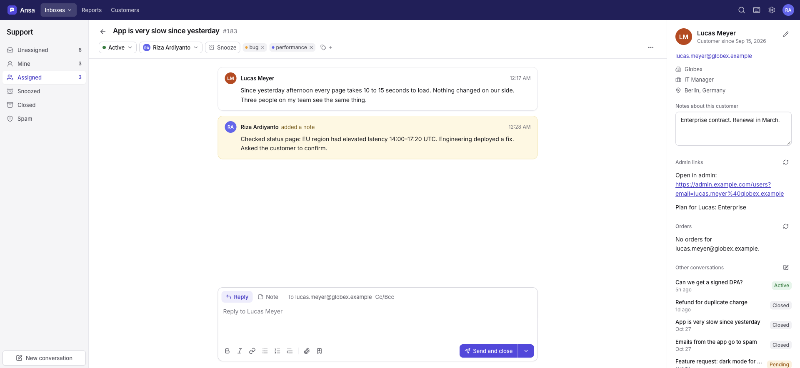

# Build an app for Ansa

An app connects Ansa to your other tools. It can do three things:

| What | How | Code needed |
|---|---|---|
| Show content beside a conversation | **Sidebar** | None for text and links. A small web endpoint for live data. |
| React when something happens | **Webhook** | A small web endpoint. |
| Change things in Ansa | **API** or **MCP** | A few HTTP calls. |

An app is a web address you own. You do not install code into Ansa, so an app cannot break your help desk, and the same app works on a VPS and on Cloudflare.

Create apps in **Settings → Apps**. Only admins can.



## Level 1: text and links, no code

This takes one minute.

1. Open **Settings → Apps → New app**.
2. Name it, for example `Admin links`.
3. Under **Sidebar**, choose **Text and links (no code)**.
4. Write the content:

   ```
   [Open in admin](https://admin.example.com/users?email={{customer.email|url}})
   [Find in Stripe](https://dashboard.stripe.com/search?query={{customer.email|url}})

   Company: {{customer.company}}
   ```

5. Press **Create app**, then open any conversation.

Rules for the content:

- Plain text becomes paragraphs. A blank line starts a new paragraph.
- A web address becomes a link. For a link with a label, write `[label](https://…)`.
- Simple HTML works too: `<p>`, `<a>`, `<strong>`, `<ul>`, `<table>`. Scripts and styles are removed.
- Inside a link, add `|url` to a placeholder, like `{{customer.email|url}}`. It makes characters such as `+` and `@` safe in a web address.

Placeholders:

| Placeholder | Value |
|---|---|
| `{{customer.name}}`, `{{customer.firstName}}` | The customer's name |
| `{{customer.email}}` | Main email address |
| `{{customer.company}}`, `{{customer.phone}}`, `{{customer.location}}` | Profile fields |
| `{{customer.id}}` | Ansa's number for the customer |
| `{{conversation.id}}`, `{{conversation.subject}}`, `{{conversation.status}}` | The open conversation |
| `{{conversation.url}}` | Link to the conversation in Ansa |
| `{{mailbox.name}}` | The mailbox |

## Level 2: live data in the sidebar

Use this to show orders, a subscription plan, or anything else you look up for each customer.

When a teammate opens a conversation, Ansa sends a `POST` request to your **Sidebar URL**. Your endpoint answers with the HTML to show.

**Ansa sends:**

```json
{
  "event": "sidebar",
  "sentAt": "2026-11-11T03:10:00.000Z",
  "conversation": {
    "id": 183,
    "url": "https://support.example.com/c/183",
    "subject": "App is very slow since yesterday",
    "status": "active",
    "mailbox": { "id": 1, "name": "Support" },
    "assignee": { "id": 1, "name": "Maya" },
    "tags": ["bug", "performance"],
    "preview": "Since yesterday afternoon every page takes…",
    "threadCount": 2,
    "createdAt": "2026-11-10T17:17:00.000Z",
    "updatedAt": "2026-11-10T17:28:00.000Z"
  },
  "customer": {
    "id": 7,
    "name": "Lucas Meyer",
    "email": "lucas.meyer@globex.example",
    "emails": ["lucas.meyer@globex.example"],
    "company": "Globex",
    "title": "IT Manager",
    "phone": "",
    "location": "Berlin, Germany"
  }
}
```

**You answer** with status 200 and this JSON:

```json
{ "html": "<p><strong>2 orders</strong></p><ul><li>#1042 · $129.00 · Shipped</li></ul>" }
```

Ansa also accepts a plain HTML body. The JSON shape matches Help Scout's dynamic apps, so an endpoint written for Help Scout needs few changes.

Good to know:

- Answer within 8 seconds. After that, the sidebar shows an error for your app and the other apps still load.
- Ansa cleans your HTML. Text, links, lists, tables and images stay. Scripts, styles, forms and iframes are removed.
- Ansa asks again when a teammate opens the conversation later, or presses the reload button on your app.
- Escape any value you put into the HTML, as the examples do.

## Level 3: react to events with a webhook

Enter a **Webhook URL** and tick the events you want. Ansa sends a `POST` request each time one happens.

| Event | When |
|---|---|
| `conversation.created` | A conversation starts, from an email or from a teammate |
| `conversation.customer_replied` | The customer writes again |
| `conversation.agent_replied` | A teammate, or an auto reply, answers the customer |
| `conversation.note_added` | A teammate adds an internal note |
| `conversation.status_changed` | Status changes between active, pending, closed and spam |
| `conversation.assigned` | The assignee changes |
| `conversation.tags_changed` | Tags are added or removed |
| `ping` | You press **Send a test** |

The message has the same `conversation` and `customer` as the sidebar request, plus:

```json
{
  "event": "conversation.customer_replied",
  "message": {
    "id": 412,
    "type": "customer",
    "author": { "kind": "customer", "id": 7, "name": "Lucas Meyer" },
    "html": "<p>Thanks, it works now.</p>",
    "attachments": [{ "filename": "screenshot.png", "mime": "image/png", "size": 48211 }],
    "createdAt": "2026-11-11T03:10:00.000Z"
  }
}
```

Change events carry `change` instead of `message`:

```json
{ "event": "conversation.status_changed", "change": { "from": "active", "to": "closed", "by": "web" } }
```

`by` tells you who made the change: `web` (a teammate in Ansa), `api`, `mcp`, `workflow` or `system`.

Good to know:

- Answer with any 2xx status within 8 seconds. Do slow work after you answer.
- If your endpoint is down or answers 5xx, Ansa tries once more after 3 seconds. Then it gives up. It does not queue events for later.
- **Settings → Apps → your app → Recent activity** lists the last 50 deliveries with status and timing.
- "Send and close" sends `conversation.agent_replied` only. Read the new status from `conversation.status`.
- Imported old mail does not send events.

## Post to a Slack channel

No code needed. In Slack, create an app with an **Incoming Webhook** for the channel (api.slack.com/apps → Create New App → Incoming Webhooks → Add New Webhook to Workspace) and copy its URL. In Ansa, go to **Settings → Apps**, add an app, paste the URL into **Webhook URL**, and choose the events. *New conversation* and *Customer replied* are a good start.

When the webhook URL is on `hooks.slack.com`, Ansa sends a Slack message instead of its own JSON: a line that says what happened with a link to the conversation, then the subject, the message and the customer. Choose a mailbox on the app to post only that mailbox's conversations, or add one app per channel. Press **Test** to post a sample message.

## Check that a request comes from Ansa

Every request has two headers:

| Header | Value |
|---|---|
| `X-Ansa-Event` | The event name, for example `sidebar` or `conversation.created` |
| `X-Ansa-Signature` | `sha256=` followed by the HMAC-SHA256 of the raw request body, keyed with your app's signing secret, in hex |

The signing secret is on the app's page in Settings → Apps. Compute the same HMAC on your side and compare. Reject the request if they differ. Without this check, anyone who finds your address can read what your endpoint returns.

Node.js:

```js
import crypto from 'node:crypto'

function isFromAnsa(rawBody, signatureHeader, secret) {
  const expected = 'sha256=' + crypto.createHmac('sha256', secret).update(rawBody).digest('hex')
  return signatureHeader?.length === expected.length && crypto.timingSafeEqual(Buffer.from(signatureHeader), Buffer.from(expected))
}
```

PHP:

```php
$body = file_get_contents('php://input');
$expected = 'sha256=' . hash_hmac('sha256', $body, getenv('ANSA_APP_SECRET'));
if (!hash_equals($expected, $_SERVER['HTTP_X_ANSA_SIGNATURE'] ?? '')) { http_response_code(401); exit; }
$data = json_decode($body, true);
```

Python:

```python
import hmac, hashlib

def is_from_ansa(raw_body: bytes, signature: str, secret: str) -> bool:
    expected = "sha256=" + hmac.new(secret.encode(), raw_body, hashlib.sha256).hexdigest()
    return hmac.compare_digest(expected, signature or "")
```

Use the raw body, before any JSON parsing. A re-encoded body gives a different signature.

## Change things in Ansa

Your app can reply, add notes, tag, assign and close through the REST API. Create a token in **Settings → API & MCP**.

```bash
# Add an internal note
curl -X POST https://support.example.com/api/conversations/183/note \
  -H "Authorization: Bearer ansa_your_token" -H "Content-Type: application/json" \
  -d '{"bodyHtml": "<p>Refund of $129.00 started.</p>"}'

# Tag and close
curl -X PATCH https://support.example.com/api/conversations/183 \
  -H "Authorization: Bearer ansa_your_token" -H "Content-Type: application/json" \
  -d '{"addTags": ["refunded"], "status": "closed"}'
```

The README lists every endpoint. A token acts as the teammate who created it, so create a separate teammate for an app if you want its actions to show under its own name.

A common pattern: a webhook for `conversation.created` looks up the customer in your system, then calls the API to add a note and a tag.

## Start from an example

Both examples do the same thing: show a customer's orders in the sidebar, and log events.

**Cloudflare Worker** (free, nothing to host): [`examples/cloudflare-app`](../examples/cloudflare-app)

```bash
cd examples/cloudflare-app
npx wrangler deploy
npx wrangler secret put ANSA_APP_SECRET    # paste the signing secret
```

**Node.js**, one file with no dependencies: [`examples/node-app`](../examples/node-app)

```bash
ANSA_APP_SECRET=ansa_app_... node examples/node-app/server.mjs
```

Then, in Ansa:

1. Open **Settings → Apps → New app**.
2. Choose **Content from your server** and enter `https://your-address/sidebar`.
3. Enter `https://your-address/webhook` as the webhook URL and tick the events.
4. Press **Create app**. Copy the **signing secret** into your app.
5. Press **Send a test**. You see the sidebar preview and the webhook result.

Ansa must be able to reach your address. An app on `localhost` works only when Ansa runs on the same machine. For Ansa on Cloudflare, your app needs a public HTTPS address.

## When something does not work

| You see | Cause | Fix |
|---|---|---|
| "Could not reach the app" | Ansa cannot connect to the address | Check the address in a browser. Check that it is public. |
| "The app answered 401" | Your signature check failed | Use the current signing secret. Sign the raw body. |
| "The app answered 404" or "405" | Wrong path, or the endpoint does not accept `POST` | Check the path. Accept `POST`. |
| "No answer within 8 seconds" | The endpoint is too slow | Answer first, then do slow work. Cache lookups. |
| "The app must answer with JSON like {"html": "..."}" | The JSON has no `html` text field | Return `{"html": "<p>…</p>"}`. |
| The sidebar shows less than you sent | Ansa removed unsafe HTML | Use text, links, lists, tables and images only. |
| No webhook arrives | The event is not ticked, the app is off, or it is limited to another mailbox | Check the app's settings and **Recent activity**. |
